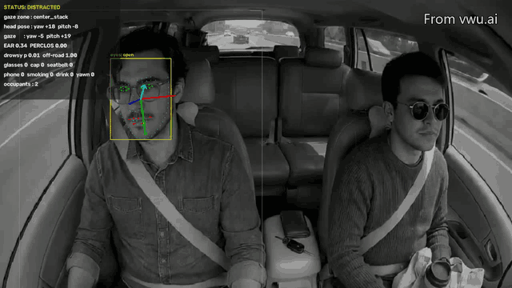

# CabinSense

Local, multi-task **in-cabin driver & occupant monitoring** (DMS/OMS). From a single
camera stream it infers, stably over time:

**drowsiness · distraction · gaze zone · yawning · phone use · drinking · smoking ·
seatbelt · glasses · cap · occupant count**

Built entirely in Python and packaged for later **SoC portability** (ONNX-everywhere
inference, a dependency-light core, a model manifest, and a deployment guide). Fully
local and open-source - no paid APIs. Developed on a 6 GB NVIDIA GPU.

## Demo



Full-resolution clip: [`outputs/dms_demo.mp4`](outputs/dms_demo.mp4). The overlay shows
98 landmarks, the 6DRepNet head-pose axis, the L2CS gaze arrow, an eyes open/closed
(blink) label, YOLO detection boxes with confidence, the driver ROI (the unshaded
region), and the temporally-smoothed state panel.

```bash
python scripts/demo_dms_video.py --input clip.mp4   # -> outputs/dms_demo.mp4
python scripts/demo_webcam.py                       # live camera
```

The clip above is public dashcam-style footage used only to exercise the pipeline
end-to-end. Read it as a systems demo, not an accuracy claim - see
[Scope and honest limits](#scope-and-honest-limits) for what it gets wrong and why.

## Approach

- **Multi-model fusion**: ONNX face detection (YuNet) + 98-pt landmarks (PFLD), robust
  head pose (6DRepNet), eye gaze (L2CS), geometry (EAR/MAR/PERCLOS), a learned
  drowsiness classifier, a COCO-pretrained YOLO object detector for object-like
  classes, and a face-attribute classifier - fused into one temporally-smoothed cabin
  state (PERCLOS window, distraction window, hysteresis; drowsiness assessed only when
  facing forward).
- **Right tool per class (detection vs classification)**: object-like behaviours are
  found with localized detectors that have a real absence concept, not whole-image
  classifiers - a whole-image head fires confidently on out-of-domain cabin frames even
  when the object is absent (measured p90 ~0.99 for phone on a clip with no phone).
  Two detection strategies by data availability: COCO-pretrained YOLO for classes COCO
  already covers (phone -> cell phone, drinking -> bottle/cup, zero training); and one
  **consolidated YOLOv8n fine-tuned locally** on merged open detection datasets for the
  classes COCO lacks (smoking, seatbelt, cap) - a single inference for all three so the
  SoC cost stays flat as classes are added. Genuine face attributes (glasses) stay a
  face-crop classifier; yawn stays MAR geometry. Open-vocabulary detection (YOLO-World)
  was tried for the data-less classes but failed zero-shot on this grayscale cabin
  domain, so supervised training is the path.
- **Driver ROI + two-rate scheduling (SoC efficiency)**: most frames process only a
  region of interest around the driver (face -> torso -> lap), so the detectors run on
  ~half the pixels at higher effective resolution on small objects; a full-frame sweep
  runs every few seconds to recount occupants and re-localize the driver. A
  `drive_side` flag (LHD/RHD, auto-initialized from the driver's position) selects the
  driver and mirrors the gaze zones.
- **Edge-first**: small backbones (MobileNetV3 / MobileViT), ONNX + INT8 quantization,
  and accuracy-vs-latency benchmarking.
- **Port-ready**: the runtime `core/` uses only ops with direct C/C++ equivalents; a
  model manifest and `deploy/DEPLOYMENT.md` document a future SoC port (no C/C++ here).

## Capability status

| Signal | Status | Source |
|---|---|---|
| Face detection / occupant count | Working | YuNet (ONNX) |
| Landmarks + EAR/MAR (blink, yawn) | Working | PFLD-98 + geometry |
| Head pose | Working | 6DRepNet |
| Gaze / distraction | Working | L2CS gaze + head pose |
| Drowsiness | Trained; benchmark saturated | MobileNetV3 on akahana - see limits |
| Phone, drinking | Working (detector) | COCO YOLOv8n (cell phone / bottle / cup); localized, absence-aware |
| Smoking, seatbelt, cap | Trained detector; RGB->grayscale domain gap | one consolidated YOLOv8n on merged open detection sets |
| Glasses | Working (classifier) | multi-task on CelebA, F1 0.914 |
| Yawn | Working (geometry) | MAR from PFLD-98 landmarks |

Every behaviour has an active implementation path. Phone/drinking use a COCO-pretrained
YOLO detector (no training, real boxes, reports absence correctly); smoking/seatbelt/cap
use one consolidated YOLOv8n fine-tuned on merged open detection datasets - a single
inference for all three, which keeps the SoC budget flat. Glasses stays a face-crop
classifier; yawn stays MAR geometry.

## Results

### Accuracy (`outputs/eval.json`)

| Model | Task | Clean | Degraded | Support |
|---|---|---|---|---|
| Drowsiness (MobileNetV3-Small) | accuracy | 0.9999 | 0.9988 | 8,359 |
| Drowsiness | macro-F1 | 0.9999 | 0.9988 | 8,359 |
| Multi-task | glasses accuracy / F1 | 0.9889 / 0.9137 | - | 1,535 |
| Multi-task | cap accuracy / F1 | 0.9837 / 0.7899 | - | 1,535 |

"Degraded" re-scores the same test split under the training augmentation stack
(photometric jitter, small affine pose shift, random erasing occlusion).

**Read the drowsiness number with care.** One misclassification in 8,359 test images
is a property of the dataset, not evidence of a solved problem:
`akahana/Driver-Drowsiness-Dataset` is built from video frames, so visually
near-duplicate frames very likely span its official train/test split. The model is
learning identity and scene as much as eyelid state. The honest reading is that this
task is saturated on this dataset and needs a subject-disjoint split (e.g. UTA-RLDD
held out by participant) before the number means anything about generalization. The
confusion matrix is in `outputs/figures/`.

`cap` F1 (0.79) trailing its accuracy (0.98) is the expected class-imbalance signature
- `Wearing_Hat` is a ~5% positive class in CelebA - and is the more informative
attribute metric of the two.

### Latency and size (`outputs/benchmark.json`, ONNX Runtime, CPUExecutionProvider)

| Model | Median | p95 | FPS | Size |
|---|---|---|---|---|
| yunet.onnx (face detection) | 3.82 ms | 11.58 ms | 262 | 0.23 MB |
| drowsiness.onnx (fp32) | 2.07 ms | 4.13 ms | 483 | 6.09 MB |
| drowsiness.int8.onnx | 13.22 ms | 20.78 ms | 76 | 1.70 MB |
| multitask.onnx (fp32) | 1.47 ms | 2.20 ms | 682 | 6.11 MB |
| multitask.int8.onnx | 15.71 ms | 23.98 ms | 64 | 1.71 MB |

The fp32 path runs the full detect + classify chain in ~7.4 ms (~135 FPS) on CPU
alone, well inside a 30 FPS camera budget with headroom to spare. These figures cover
the ONNX face/attribute chain only; 6DRepNet, L2CS, and the YOLO detectors run in
PyTorch and are not in the benchmark - see limits below.

### INT8 made these models 3.6x smaller and 6-11x slower

This is the most useful thing the benchmark surfaced, and it runs against the
default assumption that quantization is a free win.

Dynamic INT8 quantization stores weights as int8 and, on every call, computes
activation scales at run time and wraps each quantized operator in quantize and
dequantize steps. That trade pays off when the convolution arithmetic it accelerates
dominates the runtime. On MobileNetV3-Small at
128x128 the convolutions are already tiny - a 1.5-2 ms forward pass - so the
per-operator quantize/dequantize overhead is likely not amortized (no operator
profile is saved, so this is the probable mechanism rather than a measured one).
The result is a 6.4x latency regression on the drowsiness model and 10.7x on the
multi-task model, for a 3.6x size reduction.

Where each variant is the right choice:

- **fp32** wherever compute is the constraint. It is strictly faster here.
- **INT8** only where flash/RAM footprint is the binding constraint (about 8.8 MB saved
  across both models, 3.6x smaller each) and a ~15 ms budget per model is acceptable.
- **Static INT8 (QDQ)** is the documented follow-on: it folds the quantization into
  the graph and removes the per-call dequantize, which is what would actually make
  INT8 faster here. It needs a calibration set, so it is scoped, not claimed.
- **fp16** is the more likely win on a GPU or NPU target.

The general point: on already-small edge backbones, quantization is a size
optimization. Whether it is *also* a speed optimization is an empirical question
about a specific model on specific hardware, which is why this repo ships a
benchmark script rather than an assumption.

## Scope and honest limits

Read the demo clip as a systems demonstration. These are the known failures, in the
order a reviewer will notice them:

- **Driver selection is a heuristic, and it picks wrong on the sample clip.** The clip
  is right-hand-drive footage, but `infer_drive_side` votes on the *largest* face
  during the auto-init sweeps, and the front-left passenger sits closer to the camera.
  The system locks LHD and tracks the passenger as the driver. Face size is a proxy for
  camera distance, not for seat position; a production system takes drive side from
  vehicle configuration rather than inferring it. Pass `--drive-side rhd` to override.
- **The committed demo clip predates a fusion fix.** It shows `STATUS: DROWSY` at
  `drowsy p 0.53, EAR 0.30, PERCLOS 0.00` - eyes plainly open. Two bugs caused it, both
  now fixed: the learned-classifier branch bypassed the PERCLOS window entirely
  (`is_drowsy(perclos) or eye_closed_prob >= 0.5` latched on one frame), and
  `RatioWindow.ratio()` divided by samples seen rather than window capacity, so the
  first True of a stream reported a ratio of 1.0 and tripped every flag on frame one.
  Both branches are now accumulated over the same window and the ratio ramps in from
  empty. Re-run `scripts/demo_dms_video.py` to regenerate the clip against the fix.
- **RGB-trained detectors underfire on grayscale/IR footage.** Both occupants in the
  demo wear seatbelts and the seatbelt head reports 0 throughout; glasses are visible
  and unreported. Real in-cabin capture is IR or grayscale with small, steeply-angled
  faces, and every detector here was trained on RGB. Validate and fine-tune on
  driver-facing footage before drawing any conclusion about these classes.
- **The drowsiness benchmark is saturated.** See the Results caveat above. The number
  is real; what it measures is not generalization.
- **Latency numbers cover the ONNX chain only.** 6DRepNet, L2CS, and the YOLO
  detectors are PyTorch and are excluded from `benchmark.json`. The ~7.4 ms figure is
  the face/attribute path, not the full overlay pipeline.
- **`deploy/models/pfld.onnx` is not redistributed** and has no stable no-auth
  download; `scripts/download_models.py` fetches YuNet and prints placement
  instructions for PFLD. Validate the WFLW-98 index convention in
  `src/core/landmark_indices.py` against whichever export you use.
- `deploy/DEPLOYMENT.md` documents the C/C++ SoC port. No C/C++ is written in this
  repo - the deliverable is the ONNX artifacts, the manifest contract, and the
  portability specification.

## Setup

Requires Python 3.11 and an NVIDIA GPU.

```bash
python -m venv .venv
source .venv/bin/activate         # Linux / macOS
# .venv\Scripts\activate          # Windows
pip install torch torchvision --index-url https://download.pytorch.org/whl/cu126
pip install -r requirements.txt
# Head-pose (6DRepNet) is in requirements; L2CS gaze installs from source (--no-deps
# protects the CUDA build; face-detection only satisfies the l2cs import):
pip install --no-deps git+https://github.com/Ahmednull/L2CS-Net.git
pip install --no-deps face-detection
```

## Running

```bash
# 1. Pretrained detector/landmark models
python scripts/download_models.py        # downloads YuNet; prints PFLD-98 placement instructions

# 2. Train (downloads datasets on first run)
python scripts/train_drowsiness.py --epochs 8          # or --max-samples 4000 for a smoke run
python scripts/train_multitask.py --epochs 6
# Consolidated smoking/seatbelt/cap detector (needs the two Roboflow YOLOv8 zips in data/):
python scripts/prepare_seatbelt_data.py               # seatbelt source set -> data/seatbelt_yolo
python scripts/prepare_unified_detection.py \
    --smoking-zip "data/smoking.v1i.yolov8.zip" --cap-zip "data/cap dataset.v3i.yolov8.zip"
python scripts/train_object_detector.py --epochs 40    # -> deploy/models/custom_yolo.pt

# 3. Evaluate, export, verify, benchmark
python scripts/run_eval.py               # outputs/eval.json + confusion figure (clean + degraded)
python scripts/export_and_quantize.py    # deploy/models/*.onnx (+ INT8)
python scripts/verify_parity.py          # PyTorch <-> ONNX parity
python scripts/benchmark.py              # outputs/benchmark.json (latency/FPS/size)
python scripts/build_manifest.py         # deploy/model_manifest.json

# 4. Demos
python scripts/demo_dms_video.py --input clip.mp4   # full DMS overlay -> outputs/dms_demo.mp4
python scripts/demo_webcam.py            # live camera

# Tests + lint
pytest -q
ruff check src scripts tests
```

## Repository layout

See `BUILD_PLAN.md` for the full module map. Top level: `src/` (library: `core/` is
the dependency-light, C++-portable runtime logic), `deploy/` (ONNX models, manifest,
`DEPLOYMENT.md` portability guide), `scripts/` (train/eval/export/benchmark/demo),
`data/`, `outputs/`, `tests/`.

## Status

Trained, evaluated, exported (ONNX + INT8), parity-checked, and benchmarked, with a
full-pipeline video demo. PyTorch<->ONNX parity within 1.1e-6; real-time on CPU for
the ONNX chain (drowsiness 483 FPS, multi-task 682 FPS, detector 262 FPS). See
`report.md`, `outputs/`, and the limits section above. `deploy/DEPLOYMENT.md`
documents the C/C++ SoC port (no C/C++ in this repo).

## Reproducibility

All stochastic operations use `SEED = 42` (`src/config.py`).
